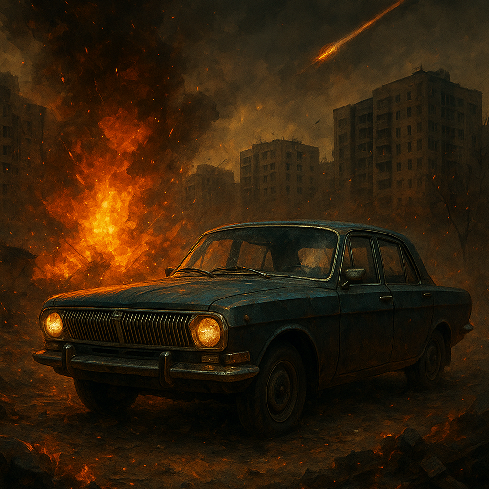
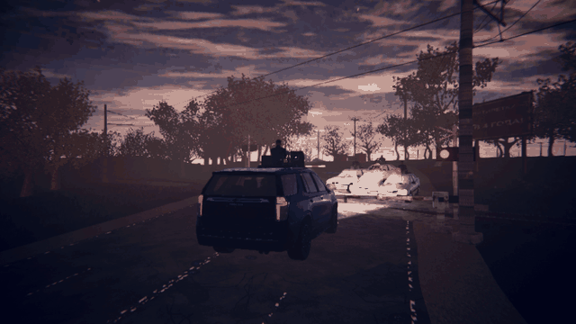
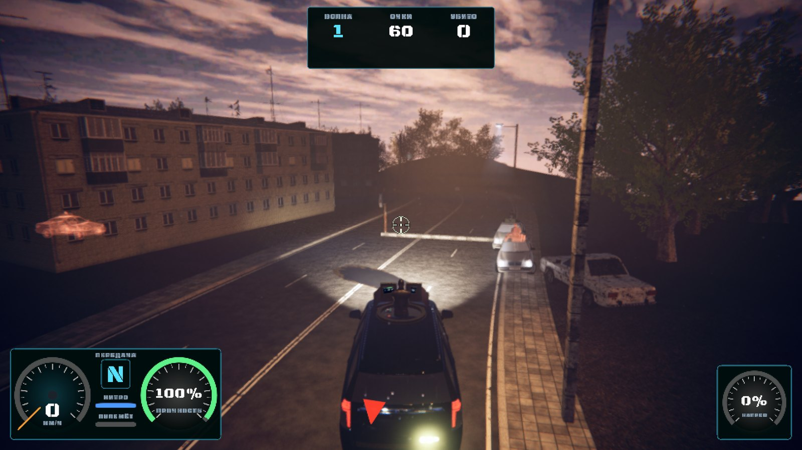
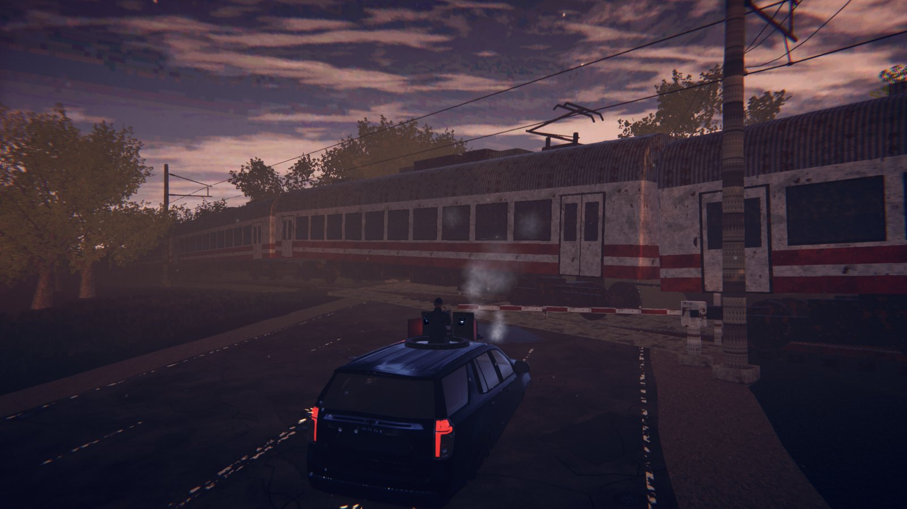
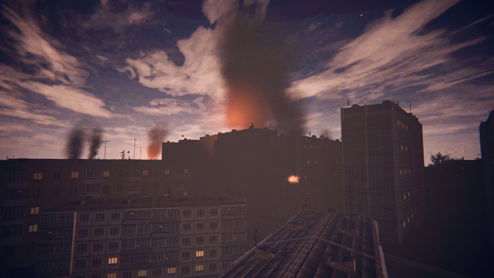
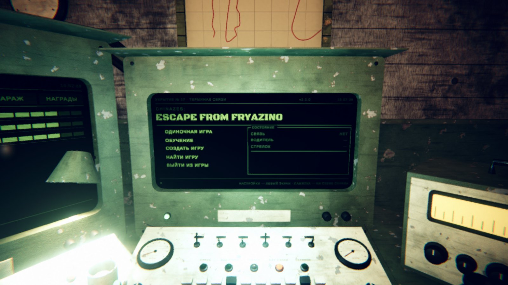

# Chinazes: Escape From Fryazino

**Город горит. Дороги перекрыты. Пути назад нет.**
Садитесь за руль бронированного внедорожника, поднимите напарника к пулемёту на крыше и прорывайтесь сквозь руины советского города, пока погоня не превратила вас в груду металлолома.

---

## Об игре

*Chinazes: Escape From Fryazino* — аркадный боевик на колёсах о побеге из охваченного войной города. Над панельками висит пепел, где-то вдали воет сирена воздушной тревоги, а по пустым проспектам за вами идут машины с турелями, гранатомётчики на «буханках» и многотонный Урал-таран.

Играйте **в одиночку** — сами ведите машину и сами стреляйте — или **вдвоём по локальной сети**: один за рулём, второй у пулемёта. Для полного погружения игра поддерживает **VR-шлем**, **руль Logitech G29**, **мехатронные платформы** и **тактильный жилет**: каждый удар, вираж и попадание вы почувствуете телом.

## Скриншоты

<table>
  <tr>
    <td></td>
    <td></td>
  </tr>
  <tr>
    <td></td>
    <td></td>
  </tr>
</table>

## Особенности

### 🚗 Погоня, в которой важна каждая секунда
- Тяжёлый внедорожник с настоящей физикой: мягкая подвеска с креном в поворотах и клевком при торможении, тормоза с ABS, занос, нитро, пробуксовка с дымом из-под колёс и следами шин на асфальте.
- Ручник: зад уходит в занос — разворот на месте, чтобы уйти от погони в переулок.
- Камера чувствует скорость: на разгоне и с нитро обзор расширяется, в поворотах кренится, от ударов и попаданий трясётся.
- Механическая коробка передач со сцеплением для руля — или автомат для одиночной игры.
- Перевернулись, угодили в овраг или слетели с обрыва в озеро? Удерживайте **R**, и машина снова на дороге. Погоня не ждёт.
- Фары с настоящим пятном света пробивают туман и дождь, мигают от ударов и гаснут, если разбить стекло.
- **Таран — тоже оружие**: врежьтесь во врага на скорости, особенно в борт, и его закрутит и разобьёт. Лёгкий седан страдает сильнее тяжёлого Урала, а ваша машина получает лишь часть удара.
- В дождь дорога скользкая, на лобовом стекле копятся капли, а дворники смахивают их; в грозу машут чаще.

### 🔥 Пулемёт на крыше
- Турель на люке поворачивается на все 360°: очереди трассерами, искры и пыль в местах попаданий, маркер попадания по врагу.
- Пулемёт перегревается: держите ритм и не дайте стволу раскалиться в самый неподходящий момент. Горячий ствол бьёт шире, а издалека пули наносят меньше урона.
- Добитый враг отмечается крупным красным крестом и отдельным звуком.
- **РПГ-7**: подберите ящик с выстрелами на дороге, и рядом с пулемётом появится гранатомёт. Одна граната разносит седан и задевает всех вокруг. Ящики лежат на карте и выпадают из подбитых «буханок» (из босса — всегда). В гранатомёт помещается до шести выстрелов.
- Попадание по машине подсвечивает край экрана с той стороны, откуда стреляли.

### 💀 Враги, которые не дают расслабиться
- Волны преследователей нарастают: машин всё больше, они крепче, метче, быстрее и стреляют больнее.
- Враги действуют вместе: заходят с флангов, держатся сзади, а кто-то вырывается вперёд и перекрывает дорогу.
- **Седаны с турелями** таранят вас бортом на полном ходу.
- **УАЗ-«буханка»** с гранатомётчиком в окне — граната летит с упреждением, но от неё можно уйти рывком.
- **Урал-таран** весом в шесть тонн разгоняется и бьёт прямо в вас.
- **Босс** каждую пятую волну — тёмно-красная машина с усиленным пулемётом.
- Со второй волны враги поджидают в засадах: во дворах, у гаражей, в частном секторе.
- **Артналёт**: со второй волны по вам бьёт артиллерия. На земле загорается красный круг, через несколько секунд свистят снаряды — уходите из круга. Стоять на месте особенно опасно.
- **Невидимый режиссёр** следит за боем: если машину зажали и она тает на глазах, даёт передышку и придерживает подкрепления; если вы слишком долго в безопасности, присылает машину с фланга. Волны подстраиваются под то, как вы справляетесь.

### 💥 Всё ломается
- Кузова мнутся от ударов, а от сильных столкновений отлетают бамперы, решётки и панели.
- Повреждённая машина дымит, перед гибелью горит и взрывается.
- Ваша машина ломается по-настоящему. От попаданий трескается лобовое стекло и бьются фары. Пробитое колесо тянет машину в сторону, и голый диск искрит по асфальту. Если пробит радиатор, из-под капота валит пар, мотор перегревается и теряет мощность. Ремкомплект чинит всё.
- Подбитый враг не просто исчезает. Остов подлетает от взрыва и переворачивается, колесо отрывается и катится по дороге, водитель вываливается наружу.
- После гибели камера медленно облетает горящую машину.
- Конусы, бочки и заграждения разлетаются от машин и пуль; горящие бочки взрываются и поджигают соседние по цепочке — заманите врагов поближе.
- Цистерны и бензовозы рвутся серией взрывов, газовые баллоны у домов и в шкафах во дворах хлопают огненными шарами, а брошенные «Жигули» и «Москвичи» взлетают на воздух и догорают обугленными остовами. Взрыв задевает соседние бочки и машины, и по улице идёт цепная реакция.
- Ларьки, остановки, будки, сараи, туалеты, ворота, деревянные столбы, рекламные щиты и поленницы разлетаются на обломки, если влететь в них на скорости. Машина проскакивает сквозь, лишь потеряв часть скорости.
- Опоры ЛЭП можно снести тяжёлой машиной, взрывом или снарядом. Опора падает, провода рвутся и искрят на земле, а заехать под них больно и вам, и врагам.
- Ремкомплекты на дорогах подлатают машину на ходу, а иногда выпадают из подбитых врагов (из босса — всегда).

### 🔊 Звук, который чувствуешь
- Мотор ревёт по оборотам, хлопает в выхлоп на сбросе газа и стучит при переключении; шины визжат в заносе и шуршат по-разному на асфальте, гравии и траве.
- Удары хрустят металлом, кузов скрежещет о стены, бьются стёкла и звенят по дороге оторванные детали.
- Вражеские пули свистят мимо ушей и звенят по броне, гильзы сыплются на крышу, перегретый ствол шипит.
- Близкий взрыв оглушает: мир глохнет, в ушах звенит. Между панельками гуляет эхо, во дворах глухо.
- На малой прочности слышно сердце, а сирена предупреждает о боссе.
- **Рация в машине**: штаб сообщает о волнах, артналётах и ремкомплектах, а сквозь шипение прорываются перехваченные переговоры врагов. Текст появляется на экране под щелчки тангенты.
- **Музыка боя подстраивается под накал**: в затишье тянется тревожный эмбиент, при погоне вступают пульс и барабаны, под обстрелом — напряжение, а для босса звучит своя тема. Клавишей `M` можно включить вместо неё магнитолу машины.

### 🌧️ Ночь, огонь и непогода
- Взрывы бьют ударной волной, плавят воздух маревом, разбрасывают горящие обломки и оставляют подпалины на асфальте.
- Забег начинается на закате: рыжее низкое солнце и тёплый туман. С каждой волной темнеет, и к десятой наступает ночь: главным светом становятся фары, фонари и пожары.
- Иногда раунд идёт под дождём или в грозу: мокрый асфальт отражает фары, из-под колёс летят брызги, по крыше стучит, сверкают молнии.
- На горизонте полыхают пожары, на блокпосту шарят прожекторы.
- Ночной город живёт: в окнах панелек горит свет, уличные фонари светят тёплым и холодным, часть мигает, разбитые не горят, а сбитый машиной фонарь гаснет со снопом искр. В квартирах пожары, над высоткой стоит столб дыма, над кварталами висит дымная пелена, у озера и в промзоне туман гуще.
- Враги за стенами видны силуэтом, а стрелки у края экрана показывают тех, кто за спиной.

### 🏙️ Мёртвый советский город
- Дворы с панельками, хоккейными коробками и лавочками, промзона, частный сектор с деревянными домами и огородами, гаражный кооператив, опоры ЛЭП, остановки с ларьками и блокпост.
- Тёмное озеро в обрывистых берегах: в воду можно сорваться — машина с плеском уходит на дно, а из-под воды всё мутно-зелёное.
- Сгоревшие остовы машин, баррикады, пепел в воздухе и туман у земли.
- Город живёт деталями: брошенные «Жигули» и «Москвичи», горки-ракеты и «ракушки» во дворах, дымящие трубы и башенный кран в промзоне, поленницы и колодцы в частном секторе, окопы и воронки на пустырях, причал с лодками и камыш у озера.
- Ориентиры видно издалека: телевышка на холме, труба ГРЭС, водонапорная башня и Дом культуры с мигающими красными огнями.
- Трамплины у дорог, перекрытые баррикадами полосы и ящики, которые разлетаются от удара. На дорогах — ремкомплекты и баллоны нитро.
- Через северный лес идёт железная дорога. Электричка в красно-сером окрасе ЭД4М гудит перед переездами, шлагбаумы опускаются, фонари мигают, звенит звонок. Не успели проскочить — поезд сомнёт машину, а врагов на путях снесёт.
- Вороны сидят на опорах ЛЭП и с карканьем срываются от выстрелов, взрывов и проезжающей машины. Во дворах частного сектора сохнет бельё, на крышах панелек треплются флаги, а бездомные собаки облаивают машину и с визгом удирают из-под колёс.
- Далёкие перестрелки, взрывы и сирена со всех сторон — фон войны, который не стихает ни на минуту.

### 📻 Задания и события
- Со второй волны штаб иногда даёт поручение, и волна кончается, только когда оно выполнено или провалено: довезти бочку солярки до блокпоста без сильных ударов, удержать блокпост 60 секунд, забрать раненого и довезти в санчасть (для погрузки нужно остановиться) или уничтожить колонну, пока она не ушла. Над точкой светится столб маяка, на экране — задание, расстояние и время, стрелка у края экрана показывает направление. За успех — очки и ремкомплект.
- Во время боя по рации предупреждают о событиях: впереди рушится ЛЭП и перекрывает дорогу, или вертолёт через 20 секунд сбросит ящик выстрелов к РПГ и ремкомплект в названной точке, или через переезд пойдёт электричка.

### ⏸️ Передышка между волнами
- Зачистили волну — надпись с итогом и бонус очков за скорость: чем быстрее, тем больше.
- Пока новая волна не выехала, машину понемногу чинят.
- В одиночной игре забег сохраняется после каждой передышки: можно выйти посреди волны и потом нажать в меню «Продолжить».
- Выбор одного из трёх улучшений на этот заезд (в VR — лучом контроллера): форсированный мотор, бронелисты, скорострельность, охлаждение ствола, бронебойные пули, баллон нитро побольше, ремонт на ходу, усиленный бампер. Каждое можно взять до трёх раз.

### 🎖️ Очки и рекорды
- Очки за каждого врага, множитель комбо за убийства подряд, бонус за быструю зачистку волны и очки за выживание в бою.
- Повтор последних секунд перед гибелью: камера облетает машину и погоню, последний миг — в замедлении.
- Экран гибели с итогом заезда и вашим лучшим результатом.
- Десять достижений: дожить до ночи, подбить босса, взорвать три бензовоза подряд, пройти волну без единой царапины и другие. Список — на вкладке «Награды» терминала в бункере.
- За каждый заезд начисляются талоны. В **гараже бункера** (вкладка «Гараж» на терминале настроек) их тратят на постоянные улучшения: броня кузова, расточка мотора, короб пулемёта (медленнее греется) и РПГ с собой с первой волны. В кооперативе действует гараж хоста.

### 🎮 Играйте как удобно
- **Обучение** на ночном загородном полигоне: шаг за шагом — руль, нитро, пулемёт, горящие бочки, засада с гранатомётом, ремонт и как поставить машину на колёса. Без волн врагов и спешки.
- **Одиночная игра** на мониторе: вид от третьего лица, водитель и стрелок в одном лице.
- **Кооператив на двоих** по локальной сети — без интернета и аккаунтов. Если в сети несколько игр, выберите нужную из списка; после обрыва связи — кнопка «Переподключиться».
- **VR** (Meta Quest 2 и другие шлемы с OpenXR), **руль Logitech G29**, **платформы 2DOF и FutuRift**, **bHaptics**. В шлеме контроллеры вибрируют от выстрелов, РПГ, попаданий и ударов кузова; есть пауза на кнопке меню, поворот плавный или рывками и затемнение краёв обзора на резких манёврах против укачивания.
- Клавиши управления машиной можно переназначить в настройках.
- Главное меню — командный пункт в бункере с экранами военного терминала.
- Гибкие настройки графики: пресеты от «Низкого» до «Ультра» и ручная настройка каждого параметра.

## Управление (одиночная игра)

| Клавиша | Действие |
|---|---|
| `W` / `S` | газ / тормоз и задний ход |
| `A` / `D` | руль |
| `Пробел` | ручник |
| левый `Shift` | нитро |
| мышь | обзор и прицел |
| ЛКМ | огонь |
| ПКМ | выстрел из РПГ (когда он есть) |
| `L` | мигалка |
| `M` | магнитола вместо музыки боя и обратно |
| `R` (удерживать) | поставить машину на колёса |
| `Esc` | пауза |
| `1` / `2` / `3` | выбор улучшения между волнами |

Газ, тормоз, руль, ручник, нитро, подъём машины, мигалку и магнитолу можно переназначить: **Настройки → Клавиши**. Стрелки работают всегда.

В кооперативе водитель управляет с руля G29 или клавиатуры, стрелок — мышью или VR-контроллерами (РПГ — левый курок).

На руле Logitech G29 работает обратная связь. Руль тяжелеет с ростом скорости и дрожит на грунте и в прыжке. При ударах его дёргает, а с пробитым колесом тянет в сторону. Диоды на руле показывают обороты. Улучшение между волнами стрелок выбирает клавишами `1`–`3` или мышью, водитель — мышью (на цифрах у него передачи). В VR улучшение выбирается само через 15 секунд.

## Как начать

1. Скачайте архив последней версии со страницы [Releases](https://github.com/Leelik12/Chinazes_Escape_From_Fryazino/releases/latest) и распакуйте в любую папку.
2. Запустите `Chinazes Escape From Fryazino.exe`.
3. Впервые? Начните с **«Обучения»**. Дальше выберите **«Одиночная игра»** — или **«Создать игру»** на одном ПК и **«Найти игру»** на другом, чтобы играть вдвоём (оба ПК в одной сети).

Без подключённого VR-шлема игра запускается на мониторе.

## Системные требования

- **ОС:** Windows 10 / 11 (64-bit)
- **Место на диске:** около 1,4 ГБ
- **Сеть:** локальная сеть — только для игры вдвоём
- **Дополнительно (необязательно):** VR-шлем с OpenXR, руль Logitech G29, платформы 2DOF / FutuRift, устройства bHaptics

Игра проверялась на ноутбуке с Intel Core i7-13700H и встроенной графикой Intel Iris Xe.
